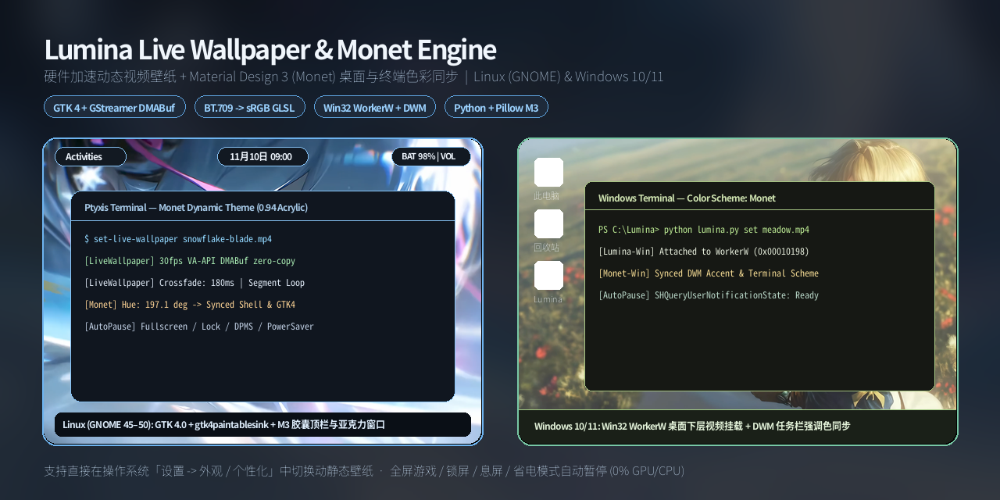
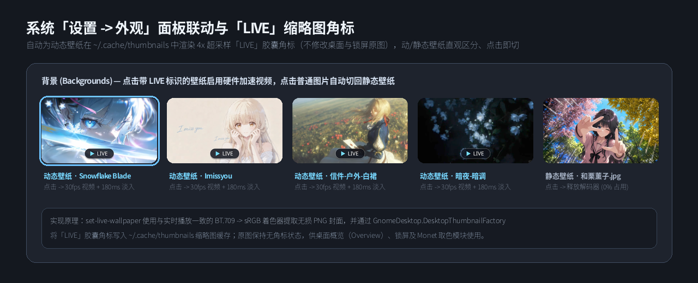
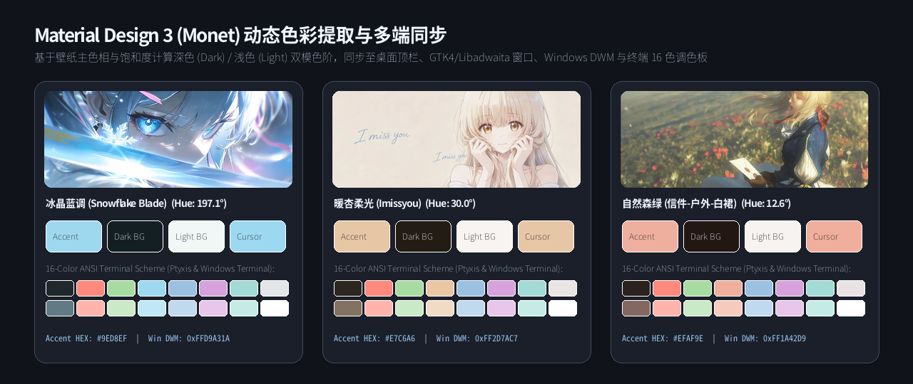
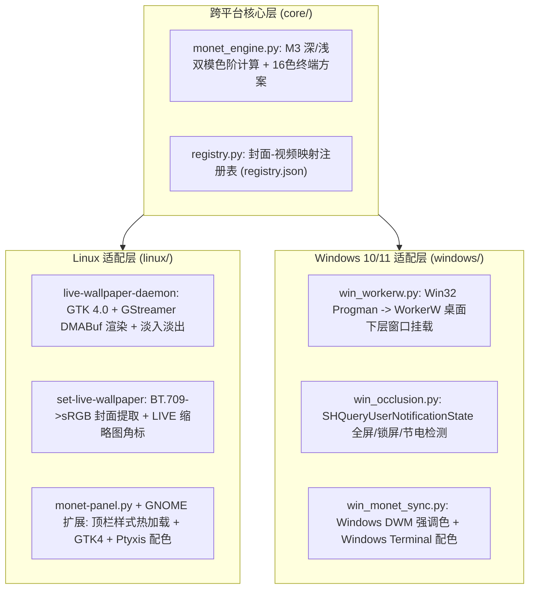

# Lumina Live Wallpaper & Monet Engine

<p align="center">
  
</p>

<p align="center">
  <b>跨平台硬件加速动态视频壁纸与 Material Design 3 (Monet) 桌面色彩同步工具</b><br/>
  支持 <b>Linux (GNOME 45–50)</b> 与 <b>Windows 10 / 11</b>
</p>

---

## 🛠️ 技术栈 (Tech Stack)

本项目采用 **「跨平台核心层 + 操作系统原生适配层」** 结构，尽可能复用系统底层自带的图形与多媒体组件，避免引入庞大的前端框架（如 Electron / CEF）：

| 层级 / 平台 | 核心组件与技术栈 | 负责功能 |
| :--- | :--- | :--- |
| **跨平台核心层 (`core/`)** | **Python 3** + **Pillow (`PIL`)** + `colorsys` | 基于 HSL 色彩空间提取壁纸主色相与饱和度，计算深色（Dark）/ 浅色（Light）双模 Material Design 3 色阶及 16 色 ANSI 终端配色方案；管理封面与视频的映射注册表（`registry.json`）。 |
| **Linux 后端 (`linux/`)** | **GJS (GNOME JS)** + **GTK 4.0** + **GStreamer 1.0** (`playbin` + `gtk4paintablesink`) | 通过 VA-API `video/x-raw(memory:DMABuf)` 实现硬件解码与 GPU 零拷贝渲染；使用 OpenGL GLSL 着色器完成 `ITU-R BT.709` $\rightarrow$ `sRGB` 传递函数转换；实现 180ms 透明度淡入淡出与 `Gst.SeekFlags.SEGMENT` 循环播放。 |
| **Linux 桌面集成** | **Gio.Settings (`dconf`)** + **Gio.DBus** + **GnomeDesktop 4.0** + **GNOME Shell Extension (`St.Theme`)** | 监听系统「设置 $\rightarrow$ 外观」壁纸变化；利用 `DesktopThumbnailFactory` 将 `▶ LIVE` 角标渲染至缩略图缓存；监听全屏窗口、锁屏（`ScreenSaver`）、息屏（`Mutter.DisplayConfig`）与省电模式（`PowerProfiles`）；同步顶栏 CSS、Libadwaita 亚克力与 Ptyxis 终端配色。 |
| **Windows 后端 (`windows/`)** | **Python `ctypes` (Win32 API)** + **mpv / FFmpeg** + **`winreg`** | 调用 `user32.dll` 向 `Progman` 发送 `0x052C` 消息定位 `WorkerW` 句柄，将硬件加速视频窗口挂载于桌面图标层（`SHELLDLL_DefView`）下方；通过 `SHQueryUserNotificationState` 与 `GetSystemPowerStatus` 检测全屏游戏/锁屏/节电状态；写入注册表同步 Windows DWM 强调色与 Windows Terminal 配色。 |

---

## 📖 项目简介 (Overview)

**Lumina** 是一个轻量级的动态视频壁纸与桌面主题色同步工具，旨在解决日常使用中的几个具体问题：

1. **与系统原生「设置」面板协同工作**：
   许多动态壁纸工具会接管整个桌面背景，导致用户无法再通过系统自带的「设置 $\rightarrow$ 外观 / 个性化」切换回普通静态壁纸。Lumina 通过在注册视频时提取同名静态封面图并写入映射表，使守护进程能够直接响应系统设置的壁纸切换信号——在系统设置中点选动态壁纸封面时播放视频，点选普通图片时自动淡出视频层并停止解码器。
2. **预览缩略图角标区分**：
   为方便在系统设置面板中区分动态壁纸与普通静态图片，工具会在生成系统缩略图缓存（`~/.cache/thumbnails`）时叠加 `▶ LIVE` 标识，而壁纸原图保持不变，不影响锁屏与概览画面。
3. **动态壁纸与系统主题色联动**：
   切换动态壁纸或静态壁纸时，内置的 Monet 取色模块会同步更新桌面状态栏、应用窗口背景色及终端 16 色调色板，保持桌面整体色调一致。
4. **低资源占用与自动暂停**：
   当桌面被全屏应用或全屏游戏遮挡、系统锁屏、显示器休眠或开启省电模式时，自动暂停视频解码，将后台 CPU/GPU 占用降至 `0%`。

---

## 🖼️ 功能展示与实现说明 (Features & Preview)

### 1. 系统「设置 $\rightarrow$ 外观」联动与 `▶ LIVE` 缩略图角标

<p align="center">
  
</p>

* **色彩空间对齐**：在 Linux 下提取视频封面帧时，通过 GStreamer OpenGL 片元着色器执行 `BT.709 EOTF` 到 `sRGB OETF` 转换，避免封面图与实时播放画面出现亮度或色彩偏差。
* **缩略图缓存注入**：利用 `GnomeDesktop.DesktopThumbnailFactory` 生成 `LARGE` (256×144) 与 `XLARGE` (512×288) 缩略图，并在底部居中安全区内绘制 4 倍超采样抗锯齿的 `▶ LIVE` 胶囊标识，适配 GNOME 外观面板的居中裁剪布局。
* **双向平滑切换**：从静态壁纸切入动态壁纸时，等待 GStreamer 管线完成首帧预解码（`async-done`）后执行 180ms 淡入过渡；切回静态壁纸时，先执行 160ms 淡出过渡，随后绑定 `1x1` 透明纹理并将管线置为 `Gst.State.NULL` 释放解码内存。

---

### 2. Material Design 3 (Monet) 色彩提取与多端同步

<p align="center">
  
</p>

* **深色 / 浅色双模色阶**：根据当前系统的配色偏好（`prefer-dark` 或 `prefer-light`），自动调整表面容器亮度与文字对比度。
* **多目标自动同步**：
  * **Linux (GNOME)**：更新 GNOME Shell 顶部状态栏胶囊样式（通过 `St.Theme` 样式表热加载避免面板闪烁）、GTK 4 / GTK 3 / Libadwaita 窗口半透明背景色、GNOME 原生系统强调色（`accent-color`）以及 Ptyxis 终端配色。
  * **Windows 10 / 11**：更新注册表 `HKCU\Software\Microsoft\Windows\DWM` 与 `Explorer\Accent`（任务栏与窗口边框强调色），并向 Windows Terminal 的 `settings.json` 写入名为 `Monet` 的 16 色主题方案。

---

## 🏗️ 系统架构流程 (Architecture)



---

## 🚀 安装与使用指南 (Quick Start)

### 🐧 1. Linux (Fedora / Ubuntu / Arch — GNOME 45~50)

#### 安装
```bash
git clone https://github.com/t0705xl/lumina-live-wallpaper.git
cd lumina-live-wallpaper
chmod +x install.sh
./install.sh
```
> `install.sh` 会自动检测包管理器（`dnf` / `apt` / `pacman`）安装所需依赖（`gjs`、`gtk4`、`gst-plugin-gtk4`、`python3-pillow`、`xprop`），并将守护进程注册为用户级 `systemd` 服务。

#### 常用命令
```bash
# 注册并启用动态视频壁纸（自动提取封面、生成 LIVE 缩略图角标并同步 Monet 配色）
set-live-wallpaper ~/Videos/your-video.mp4

# 切换至指定的静态图片壁纸
set-live-wallpaper ~/Pictures/wallpaper.jpg

# 快捷切换与维护
set-live-wallpaper --live             # 切换回最近使用的动态视频壁纸
set-live-wallpaper --static           # 切换回静态壁纸
set-live-wallpaper --refresh-badges   # 重新生成所有动态壁纸在系统设置中的 LIVE 角标
```
安装完成后，也可以直接打开 **「系统设置 $\rightarrow$ 外观」** 点击任意带 `▶ LIVE` 标识或普通壁纸进行切换。

---

### 🪟 2. Windows 10 / 11

#### 安装
1. 双击运行 **`install-windows.bat`**（或在终端执行）：
   - 自动安装 Python 依赖 `Pillow`，并通过 `winget` 检查安装 `mpv` 播放器；
   - 在当前用户注册表 `Run` 项中配置开机后台自启。
2. **设置壁纸**：
   - **拖拽方式**：直接将 `.mp4` 视频文件拖拽到 `windows\set-live-wallpaper.bat` 上；
   - **命令行方式**：
     ```powershell
     python lumina.py set C:\Videos\your-video.mp4
     ```
3. 当在「Windows 设置 $\rightarrow$ 个性化 $\rightarrow$ 背景」中切换为普通静态壁纸时，后台进程会自动检测壁纸路径变化并停止视频播放。

---

## 📂 目录结构 (Directory Structure)

```text
lumina-live-wallpaper/
├── assets/                    # README 功能说明与预览图
├── lumina.py                  # 跨平台统一 CLI 入口 (自动识别 Linux / Windows)
├── core/                      # 跨平台核心层
│   ├── monet_engine.py        # Material Design 3 (Monet) 深/浅双模色彩计算模块
│   └── registry.py            # 跨平台封面-视频映射注册表管理
├── linux/                     # Linux (GNOME 45–50) 适配层
│   ├── live-wallpaper-daemon  # GTK 4.0 + GStreamer DMABuf 守护进程
│   ├── set-live-wallpaper     # 封面提取 + LIVE 缩略图角标 + XML 同步脚本
│   ├── monet-panel.py         # GNOME 顶栏 + GTK4/3 + Ptyxis 配色同步守护进程
│   ├── extension/             # GNOME Shell 样式热加载与全屏遮挡检测扩展
│   └── systemd/               # systemd 用户服务单元配置
├── windows/                   # Windows 10/11 适配层
│   ├── win_workerw.py         # Win32 Progman/WorkerW 桌面下层窗口挂载与透明度控制
│   ├── win_occlusion.py       # Win32 SHQueryUserNotificationState 全屏/锁屏/节电检测
│   ├── win_monet_sync.py      # Windows DWM 强调色与 Windows Terminal 配色同步
│   ├── win_wallpaper_daemon.py# Windows 动态壁纸守护进程
│   └── set-live-wallpaper.bat # Windows 拖拽/命令行快捷设置脚本
├── install.sh                 # Linux 安装脚本 (支持 Fedora / Ubuntu / Arch)
├── uninstall.sh               # Linux 卸载脚本
├── install-windows.bat        # Windows 安装与自启配置脚本
└── uninstall-windows.bat      # Windows 卸载脚本
```

---

## 📄 开源协议 (License)

本项目基于 [MIT License](LICENSE) 开源。
